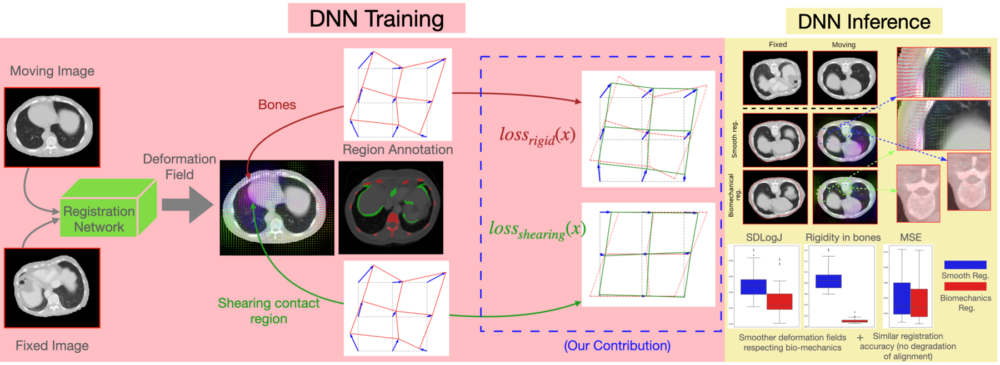
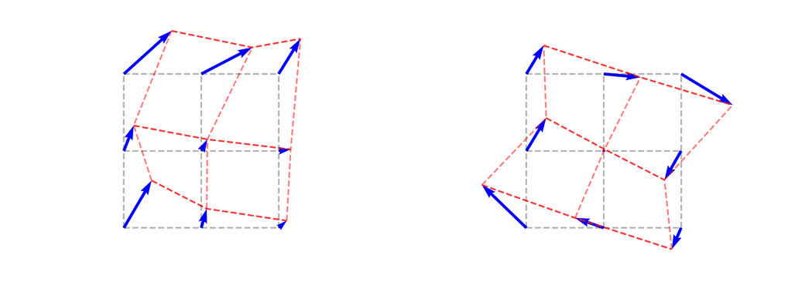
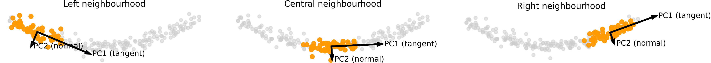

<div align="center">

# Biomechanical DLIR

**Physics-informed deep learning image registration.**
Losses derived from solid mechanics enforce local rigidity and sliding constraints, learned from data and transferred to unseen patients.

[](https://arxiv.org/abs/2504.05444)
[](https://doi.org/10.5281/zenodo.21969012)
[](https://huggingface.co/spaces/HocusPocus98/biomechanical-dlir-loss-playground)
[](LICENSE)
[](https://www.python.org/downloads/release/python-3100/)



</div>

## What this is

Standard regularization in deformable image registration applies the same smoothness penalty everywhere in the image. Real anatomy does not behave that way: a rib should move rigidly, the lung should be free to slide against the thoracic cage, and everything else deforms somewhere in between. Enforcing one uniform constraint on all of this either over-smooths the rigid parts or under-constrains the sliding ones.

This repository implements a training framework where the *nature* of the regularization loss, not just its strength, changes depending on where you are in the image. Three losses derived from solid mechanics are combined:

- **Rigidity loss**, penalizing deviation from a locally rigid displacement, applied in hard tissues (bone).
- **Shearing loss**, constraining displacement along the normal of a sliding interface while leaving tangential motion free, applied at tissue boundaries such as the pleura.
- **Jacobian loss**, a standard log-Jacobian smoothness penalty, used as the default everywhere else.

These annotations (bone masks, sliding interfaces, interface normals) are only needed during training. At inference, the network takes two images and outputs a deformation field, nothing else. The paper shows that a network trained this way keeps the rigid/sliding distinction on patients it has never seen.

## How the loss works

A minimal, single-instance view of what each loss does to a small displacement field, gradient descent on a 3x3 grid, no network involved:

<p align="center">
  
</p>

The rigidity loss pulls a distorted grid back toward a locally rigid shape. The sliding loss only constrains motion along the interface normal, so the grid keeps its tangential shear instead of being flattened out.

**[Try it live](https://huggingface.co/spaces/KZ98/biomechanical-dlir-loss-playground)**: a small interactive playground that optimizes a single 2D displacement sample under each loss, built to build intuition for what each term actually does, not to reproduce the paper's results.

At training time, the interface normal used by the shearing loss is estimated locally with PCA over a small neighborhood along the sliding surface:



## Results

On synthetic data with known ground truth, the biomechanical loss reduces the rigidity error by roughly two orders of magnitude compared to standard smoothing, at a small cost in alignment accuracy. The same pattern holds on real CT data: bone rigidity error drops from 1.14 to 0.01 on patients held out from training, with no meaningful change in Dice score. Full metrics, ablations, and per-organ breakdowns are in the paper.

## Repository structure

```
biomechanical_DLIR/
├── AbdomenCTCT_data_generation/   # scripts to build training masks from the Learn2Reg dataset
├── biomechanical_DLIR/
│   ├── main.py                    # training entry point
│   ├── eval.py                    # evaluation at training resolution
│   ├── eval_full_res.py           # evaluation at full resolution (AbdomenCTCT)
│   ├── configs/                   # JSON configs for every experiment in the paper
│   └── src/
│       ├── datasets/              # dataset classes (synthetic, AbdomenCTCT)
│       ├── losses/                # rigidity, shearing, Jacobian, Dice, NCC, MI, MSE, bending
│       ├── models/                # registration network backbone
│       └── utils/
├── requirements.txt
└── LICENSE
```

## Install

```bash
conda create --name biomechanical_DLIR python=3.10
conda activate biomechanical_DLIR
pip install -r requirements.txt
```

## Quickstart: train a model

Model, dataset, loss, and optimizer are all specified through a single JSON config, so a training run is one command:

```bash
python biomechanical_DLIR/main.py -m biomechanical_DLIR/configs/simulated_configs_grid/RigidityDet/MSE_strainDet0_99.json
```

This runs on the synthetic `D_rigid`/`D_shearing`-style data with no external dataset download required, the fastest way to see the framework working end to end. Models and logs are saved under `results/`.

Every config used in the paper's grid search is included under `biomechanical_DLIR/configs/`:
- `simulated_configs_grid/` — synthetic rotation dataset
- `simulatedShear_configs_grid/` — synthetic shearing dataset
- `abdomenCTCT_grid/` — Learn2Reg AbdomenCTCT dataset

Evaluate a trained model with `eval.py`, or `eval_full_res.py` for full-resolution evaluation on AbdomenCTCT:

```bash
python biomechanical_DLIR/eval.py -h
python biomechanical_DLIR/eval_full_res.py -h
```

## Training on real data (AbdomenCTCT)

To reproduce the clinical results, download and preprocess the Learn2Reg AbdomenCTCT dataset first:

```bash
mkdir Datasets/
wget -P Datasets/ https://cloud.imi.uni-luebeck.de/s/32WaSRaTnFk2JeT/download/AbdomenCTCT.zip
unzip Datasets/AbdomenCTCT.zip -d Datasets/
rm -r Datasets/AbdomenCTCT.zip
```

Then generate the regularization masks (bone labels, sliding interfaces, and interface normals) using TotalSegmentator:

```bash
python AbdomenCTCT_data_generation/reorient_images.py
python AbdomenCTCT_data_generation/segmentTotalSegmentator.py   # GPU strongly recommended
python AbdomenCTCT_data_generation/make_physics_loss_masks.py
```

This produces `Datasets/AbdomenCTCT_reoriented/`, including a `segmentationsTr/` folder, which the AbdomenCTCT training configs expect.

## Adding a custom dataset, loss, or model

Everything is resolved by name at runtime, so extending the framework means adding a single file.

**Dataset** → [`src/datasets/<name>_dataset.py`](biomechanical_DLIR/src/datasets/) → class `<Name>Dataset(BaseDataset)` → `"dataset_name": "<name>"`

**Loss** → [`src/losses/<name>_loss.py`](biomechanical_DLIR/src/losses/) → class `<Name>` → `"loss_name": "<name>"`

**Model** → [`src/models/<name>.py`](biomechanical_DLIR/src/models/) → class `<Name>(BaseModel)` → `"model_name": "<name>"`

Example: a dataset called `nlst` lives at `src/datasets/nlst_dataset.py`, defines `NlstDataset(BaseDataset)`, and is selected with `"dataset_name": "nlst"` in the config JSON.

## Limitations

- Neural networks are continuous by construction, so it cannot express a true discontinuity. What the shearing loss produces is a sharp, spatially concentrated approximation of sliding, not a real jump.
- All clinical results come from a single cohort (Learn2Reg AbdomenCTCT). Cross-scanner, cross-modality, and cross-anatomy generalization are not evaluated here.

## Citation

```bibtex
@misc{kheil2025biomechanicalconstraintsassimilationdeeplearning,
      title={Biomechanical Constraints Assimilation in Deep-Learning Image Registration: Application to sliding and locally rigid deformations},
      author={Ziad Kheil and Soleakhena Ken and Laurent Risser},
      year={2025},
      eprint={2504.05444},
      archivePrefix={arXiv},
      primaryClass={cs.CV},
      url={https://arxiv.org/abs/2504.05444},
}
```

The archived, versioned code used for the experiments in the paper (v1.0.0) is on Zenodo: [10.5281/zenodo.21969012](https://doi.org/10.5281/zenodo.21969012).

## License

MIT, see [LICENSE](LICENSE).
